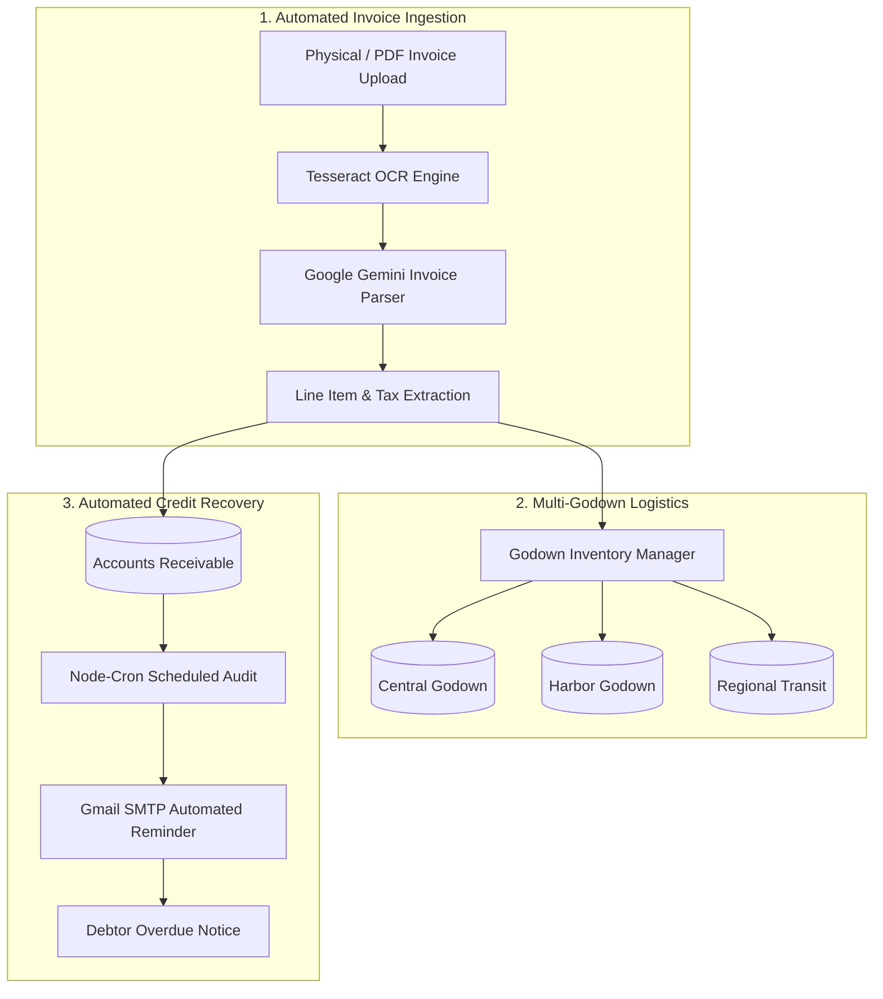

# ProjectMald: Enterprise Trading ERP, Multi-Godown Inventory & AI Invoice Intelligence 🏢📦

<div align="center">

[](https://react.dev)
[](https://www.typescriptlang.org/)
[](https://expressjs.com/)
[](https://ai.google.dev/)
[](https://tesseract.projectnaptha.com/)
[](https://tailwindcss.com/)

**Comprehensive Supply Chain ERP Platform — Featuring Multi-Godown Stock Sync, Automated OCR Invoice Ingestion, Credit Recovery Workflows & Gemini AI Assistant.**

</div>

---

## 📖 Overview

**ProjectMald** is an enterprise-grade Trading & Wholesale Management ERP system engineered by **A Generative Slice**. Built for high-volume trading and distribution operations, it bridges physical warehouse logistics with modern generative AI capabilities.

The platform centralizes multi-location godown inventory, automates supplier invoice extraction using **Tesseract OCR** and **Google Gemini AI**, monitors overdue customer credit with automated email dunning workflows, and provides executive decision support through real-time financial telemetry.

---

## 🌟 Key Functional Pillars



### 1. 🤖 AI-Powered Invoice Parsing & OCR
- Upload scanned supplier bills, handwritten slips, or PDF invoices.
- Combines **Tesseract.js** computer vision with **Google Gemini (`@google/generative-ai`)** to extract invoice numbers, vendor details, tax breakdowns (CGST/SGST/IGST), line-item quantities, and unit rates into structured records.

### 2. 🏬 Multi-Godown Stock Management
- Real-time stock visibility across distributed warehouse locations (`ALL_GODOWNS`).
- Inter-godown transfer requisitions, safety stock thresholds, and low-inventory alerts.

### 3. 💳 Credit Recovery & Automated Email Reminders
- Tracks credit terms (30/60/90 days) and outstanding client invoices.
- **Node-Cron** background jobs automatically identify delinquent accounts and trigger courteous, branded recovery notices via **Nodemailer**.

### 4. 📊 Executive Analytics & PDF Generation
- Interactive revenue, profit margin, and inventory turnover dashboards powered by **Recharts**.
- Instant compilation and export of client quotations, delivery challans, and bills using **jsPDF**.

---

## 🛠️ Technology Stack

- **Client Architecture**: React 18, Vite, TypeScript, Tailwind CSS, Radix UI Primitives, shadcn/ui components, Material UI Icons, Framer Motion, Lucide React.
- **Server Architecture**: Node.js, Express.js (TypeScript executed via `tsx watch`), CORS, Body-Parser.
- **Artificial Intelligence**: Google Gemini 1.5 / 2.0 (`@google/generative-ai`), Tesseract.js OCR.
- **Automation & Scheduling**: `node-cron`, `nodemailer` (authenticated via Google App Password).
- **Document Compilation**: `jspdf`, `html2canvas`, `pdfjs-dist`.

---

## 📂 Repository Structure

```
ProjectMald/
├── server/
│   ├── index.ts                # Express API entry point & cron orchestrator
│   ├── db.js                   # Godown inventory schema & mock database
│   └── ai.js                   # Google Gemini invoice parsing & prompt engine
├── src/
│   ├── components/             # Radix & shadcn/ui components (Dialogs, Tables, Modals)
│   ├── views/                  # ERP Screens (Inventory, Invoices, Godowns, Analytics)
│   ├── lib/                    # OCR utils, PDF generators, formatting helpers
│   ├── App.tsx                 # Main application dashboard shell
│   └── main.tsx                # Frontend entry point
├── guidelines/                 # Operational trading & godown guidelines
├── default_shadcn_theme.css    # Core design tokens and CSS custom properties
├── package.json                # Project dependencies and concurrent scripts
├── vite.config.ts              # Vite frontend configuration
└── .env.example                # Environment variable template
```

---

## ⚙️ Environment Configuration

Create a `.env` file in the root directory:

```env
# Server
PORT=5000

# Google Gemini AI
GEMINI_API_KEY=your_google_gemini_api_key

# Credit Recovery SMTP
GMAIL_USER=your_organization_email@gmail.com
GMAIL_APP_PASSWORD=your_16_digit_google_app_password
```

---

## 🚀 Getting Started

### Local Development

```bash
# 1. Clone repository
git clone https://github.com/A-Generative-Slice/ProjectMald.git
cd ProjectMald

# 2. Install dependencies
npm install

# 3. Start client and server concurrently
npm run dev
```

The system will start:
- **Frontend**: `http://localhost:5173` (Vite)
- **Backend API**: `http://localhost:5000` (Express)

### Running Components Individually

```bash
# Run backend server only
npm run dev:server

# Run frontend client only
npm run dev:client
```

---

## 📄 License & Attribution

Designed and engineered by **A Generative Slice** for enterprise trading logistics.  
Copyright © 2026 A Generative Slice. All rights reserved.